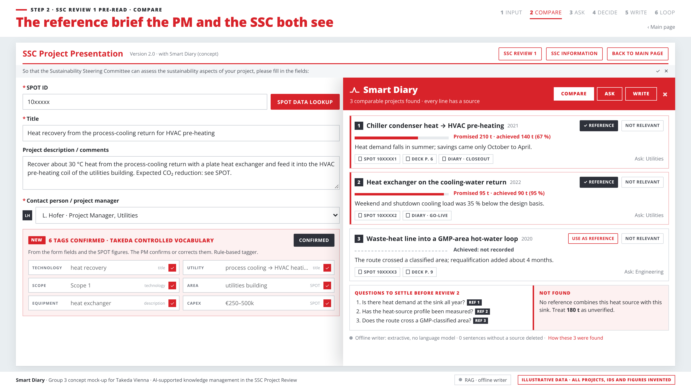
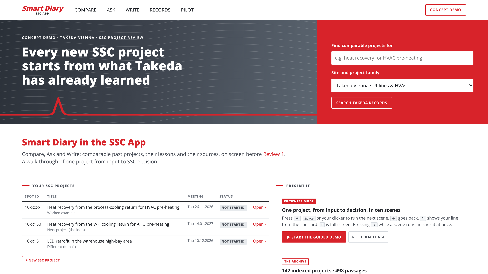
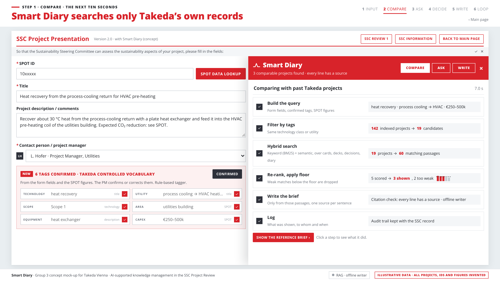
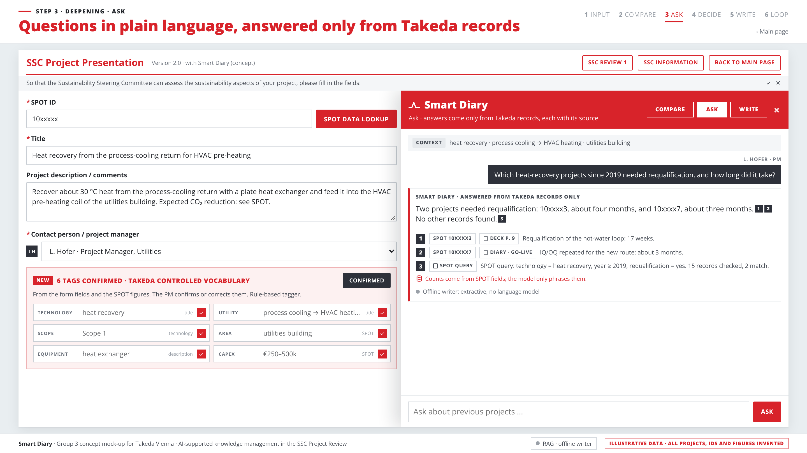
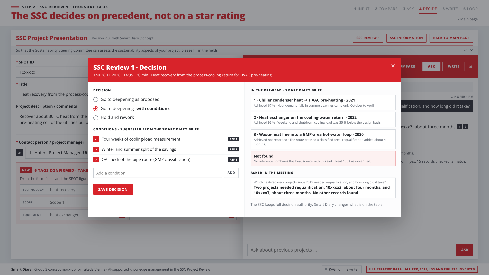
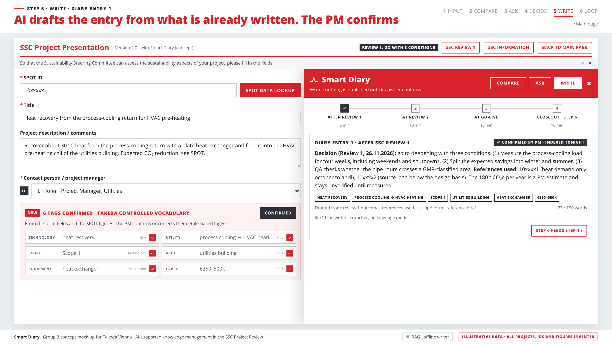
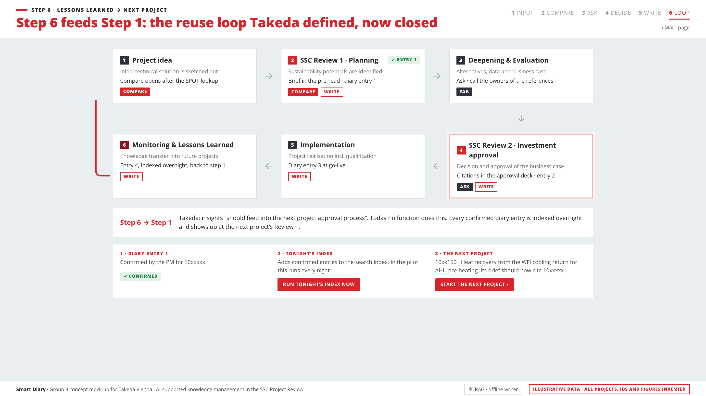
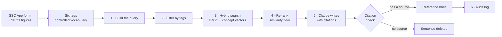
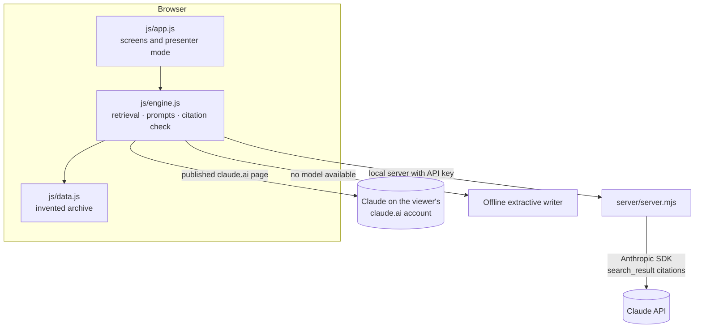

# Smart Diary

**Every new SSC project starts from what Takeda has already learned.**

Smart Diary is a concept for an AI assistant inside the *SSC App*: the tool project managers at Takeda Vienna use to submit sustainability projects to the Sustainability Steering Committee (SSC). When a project manager creates a new project, Smart Diary finds the most comparable past projects, shows what they promised, what they achieved and what went wrong, and gives every line a source. This repository holds a working version of that concept, built for Group 3's final pitch on 17 November 2026.



> **Illustrative data.** Every project, SPOT ID, person and figure in this repository is invented to show the format. The form fields follow the real SSC App (version 2.0); nothing else comes from Takeda's systems.

---

## Contents

- [The problem](#the-problem)
- [The idea: Compare, Ask, Write](#the-idea-compare-ask-write)
- [See it](#see-it)
- [How it works: retrieval-augmented generation](#how-it-works-retrieval-augmented-generation)
- [Technology](#technology)
- [Run it](#run-it)
- [Project structure](#project-structure)
- [Tests](#tests)
- [What is real and what is simulated](#what-is-real-and-what-is-simulated)
- [The pilot we propose](#the-pilot-we-propose)
- [Background and AI transparency](#background-and-ai-transparency)

---

## The problem

Every sustainability project at the site goes through the same six steps, with two SSC reviews:

1. Project idea → 2. SSC Review 1 → 3. Deepening → 4. SSC Review 2 → 5. Implementation → 6. Monitoring and lessons learned

Step 6 is called *knowledge transfer into future projects*, but nothing connects it to step 1. The knowledge exists: figures in **SPOT** (the site's single point of truth for CO₂, energy, water and waste per project), reasoning in the **approval decks**, decisions in the **Thursday SSC reviews**, and the most valuable part (why an option was rejected, what went wrong) only in **people's heads**. At Review 1 the committee sees a title, a free-text description and a star self-rating. No past project appears anywhere.

## The idea: Compare, Ask, Write

Smart Diary adds three functions to the steps that already exist. No new meeting, no new approval step.

| Function | When | What it does |
|---|---|---|
| **Compare** | Step 1 and Review 1 | Shows the three to five most comparable past projects: promised vs achieved, one lesson each, the source down to the page, whom to ask. It also says honestly when nothing fits. |
| **Ask** | Deepening and Review 2 | Answers questions in plain language, in English or German, **only from Takeda's records**, each sentence with its source. Counts come from SPOT, not from the language model. |
| **Write** | Four existing gates | Drafts a short diary entry from what is already written (form, decision, references). Nothing is published until the project manager confirms it. Confirmed entries are indexed overnight, so **step 6 feeds step 1** of the next project. |

The only new thing the project manager does is confirm six suggested tags from a controlled vocabulary (technology, utility, scope, area, equipment, CAPEX), which takes about 30 seconds.

## See it

The app follows one invented project from input to SSC decision: *heat recovery from the process-cooling return for HVAC pre-heating*, PM estimate 180 t CO₂e per year.

| | |
|---|---|
|  **Main page.** Search and the list of SSC projects. |  **Search.** The six steps run for real: 142 indexed projects → 19 candidates → 60 passages → 5 scored → 3 shown. |
|  **Ask.** The count comes from a SPOT query, and every sentence has a source. |  **SSC decision.** Conditions come from the lessons of the references. |
|  **Write.** Diary entry 1 is drafted from the form and the decision, then confirmed. |  **The loop.** The confirmed entry is indexed and shows up in the next project's brief. |

A **presenter mode** runs the walkthrough as ten scenes, one per key press (`→`, `Space` or a presentation clicker). `N` shows the speaker's line for the scene, and `F` switches to full screen. The [presenter guide](docs/PRESENTER-GUIDE.md) has what to say in each scene and answers to likely questions.

## How it works: retrieval-augmented generation

Smart Diary uses **RAG** (retrieval-augmented generation, Lewis et al., 2020): it first looks up the relevant records, then a language model writes **only from those records**, with a source for every sentence.



| Step | What happens | In the worked example |
|---|---|---|
| **1 · Build the query** | Title and description of the form, the six confirmed tags, the SPOT figures | heat recovery · process cooling → HVAC heating · €250–500k |
| **2 · Filter by tags** | Keep projects with the same technology class or the same utility | 142 indexed projects → 19 candidates |
| **3 · Hybrid search** | Every passage (SPOT card, deck page, SSC decision, diary entry) is scored ½ keyword (BM25, normalised) + ½ meaning (cosine similarity of concept vectors) | 19 projects → 60 matching passages |
| **4 · Re-rank, apply the floor** | The top 5 projects are re-scored as 0.55 × tag match + 0.45 × text match; anything under the floor of 0.70 is dropped | 5 scored → 3 shown, 2 too weak |
| **5 · Write** | Claude receives only the passages of the shown projects and writes one lesson, one question and one condition per reference | One lesson per reference, each with its source |
| **Citation check** | Every sentence must carry a citation. A sentence without one is deleted and shown struck through | 0 to n sentences deleted |
| **6 · Log** | What was shown, to whom and when | Audit log entry |

Four rules keep it reliable:

- **Tags before semantics.** With tens of projects, a controlled vocabulary does more than a bigger model.
- **No source, no sentence.** Uncited sentences are deleted. If nothing passes the floor, the answer is "not found".
- **Numbers come from SPOT.** Counts and totals are queries on SPOT fields; the model only phrases them.
- **People decide.** Smart Diary retrieves and cites. It never recommends a decision.

**German and English.** Some records are in German. The concept vocabulary is bilingual ("Abwärmenutzung" and "waste heat recovery" share one concept), so a German record is found by an English question and the other way round.

## Technology

| Layer | Technology |
|---|---|
| **App** | Plain HTML, CSS and JavaScript (ES2020). No framework and no build step needed to run it |
| **Retrieval** | Own JavaScript engine, shared by browser and server: BM25 keyword scoring, bilingual concept vectors with cosine similarity, tag filter, re-ranker, similarity floor |
| **Language model** | **Claude Opus 5.5** (`claude-opus-5-5`) by Anthropic |
| **Citations** | The retrieved passages are sent as `search_result` content blocks with citations enabled; Claude's `search_result_location` citations map each sentence back to its passage |
| **Tag suggestion** | Claude with structured output (`output_config.format` with a JSON schema that only allows vocabulary values); a rule-based tagger as fallback |
| **Server** | Node.js (20.12 or newer) with the built-in `http` module and one dependency, the official Anthropic SDK [`@anthropic-ai/sdk`](https://www.npmjs.com/package/@anthropic-ai/sdk). Refusal fallback enabled (`server-side-fallback-2026-07-01`) |
| **Published page** | A claude.ai Artifact. There, Claude runs on the viewer's own claude.ai account (the `sample` capability). Passages are numbered `[S1] [S2] …` and Claude ends every sentence with the numbers it used, which become the citations |
| **Offline fallback** | An extractive writer composes the text straight from the retrieved passages, so the demo works without a network or a model |
| **Storage** | The browser's `localStorage` (demo state only, per browser) |
| **Tests** | Node's built-in test runner (`node:test`); Playwright for browser walkthroughs during development |
| **Build** | A short Node script that inlines everything into one HTML file |



Whichever writer answers, retrieval, numbers and the citation check are the same. If a call to Claude fails, the app falls back to the offline writer and says so on screen.

## Run it

| Way | How | Who writes the text |
|---|---|---|
| **Published link** | Open the claude.ai link of the page (ask the team to share it with you) | Claude, on your claude.ai account. The page asks once for permission |
| **Double-click** | Open [`dist/smart-diary.html`](dist/smart-diary.html) on GitHub, click *Download raw file*, then double-click the file (Chrome or Edge) | Offline writer. No install, no internet |
| **Local server** | See below | Offline writer, or Claude with an API key |

### Local server

Requires [Node.js](https://nodejs.org/) 20.12 or newer.

```bash
git clone https://github.com/Sepidehri/Takada.git
```

```bash
cd Takada
```

```bash
npm install
```

```bash
npm start
```

Then open http://localhost:3000.

### With Claude

Copy the example settings file:

```bash
cp .env.example .env
```

Open `.env` and set `ANTHROPIC_API_KEY` to an API key from the [Claude Developer Platform](https://platform.claude.com/). The `.env` file is git-ignored and never committed. Restart with `npm start`; the terminal then prints `Generation: Claude (claude-opus-5-5, effort low)`, and the footer of the app shows **RAG · Claude**.

| Setting in `.env` | Default | Meaning |
|---|---|---|
| `ANTHROPIC_API_KEY` | none | Your Anthropic API key. Without it, the offline writer answers |
| `SMART_DIARY_MODEL` | `claude-opus-5-5` | The Claude model |
| `SMART_DIARY_EFFORT` | `low` | `low` is fastest for a live demo; `medium` or `high` gives richer text |
| `PORT` | `3000` | Port of the local server |

### Server API

The local server exposes five endpoints. The four `POST` endpoints run retrieval on the server, call Claude and apply the citation check.

| Endpoint | Body | Returns |
|---|---|---|
| `GET /api/health` | none | Whether a model is connected, which one, and the archive size |
| `POST /api/rag/tags` | `{form}` | Six tags from the vocabulary |
| `POST /api/rag/brief` | `{query, extras}` | The retrieval steps and the reference brief |
| `POST /api/rag/ask` | `{question, context, extras}` | The answer, its sources, and the deleted sentences |
| `POST /api/rag/draft` | `{input}` | The drafted diary entry |

## Project structure

```
index.html              entry page
css/app.css             styles
js/data.js              the invented archive (142 projects, 498 passages), vocabulary, presenter script
js/engine.js            RAG engine shared by browser and server: tags, retrieval, prompts,
                        offline writer, citation check
js/app.js               the application: SSC form, Smart Diary panel, decision, diary,
                        loop, records, audit log, pilot page, presenter mode
server/server.mjs       Node server: serves the app and calls Claude
scripts/build.mjs       builds dist/smart-diary.html (one file, works offline) and
                        dist/smart-diary.artifact.html (the claude.ai page)
test/engine.test.js     tests for the engine
docs/screenshots/       images used in this README
```

After changing anything in `js/` or `css/`, rebuild the single-file versions:

```bash
npm run build
```

## Tests

```bash
npm test
```

The 19 tests check, among other things, that:

- the six tags for the worked example come out right, and all come from the vocabulary;
- retrieval for the worked example gives 142 → 19 → 60 → 5 → 3, with the expected three references;
- a sentence without a source is deleted, whichever writer produced it;
- the requalification question is answered from a SPOT query, with two sources;
- questions without precedent ("Did any project use hydrogen?") return "not found";
- the Gate B demo set reaches at least 70 % relevant answers and 90 % correct "not found";
- a confirmed diary entry is found by the next project (the loop).

The app's **PILOT** page runs the same Gate B demo set in the browser and shows the results.

## What is real and what is simulated

| Real | Simulated |
|---|---|
| Retrieval, scoring, floor and every number on screen are computed | The archive is invented (142 projects in 12 technology classes) |
| Claude writes the brief, the answers and the diary entry (with an API key or on claude.ai) | Without a model, an extractive writer stands in |
| The citation check deletes sentences without a source | The SSC App is a mock-up of the v2.0 form, not the real app |
| Counting questions run as queries on SPOT fields | SPOT lookup returns invented figures for three demo IDs (`10xxxxx`, `10xx150`, `10xx151`) |
| The audit log records every action | The overnight index is a button |

## The pilot we propose

| | |
|---|---|
| **Scope** | Six months, Takeda Vienna, utilities and HVAC projects, Review 1 only |
| **Cost** | About €75k: 122 person-days of internal time plus cloud |
| **Gate A, week 4** | Is the data there? At least 70 % of 20 sampled projects have a deck and SPOT figures |
| **Gate B, week 12** | Is the quality good enough? At least 70 % relevant references on 50 test questions, under 5 % wrong citations |
| **Gate C, week 24** | Is it used? At least 70 % of pilot proposals cite a reference |
| **Today's ask** | **Approve Phase 0:** a four-week data check on 20 past projects, about 12 person-days, roughly €7k |

*The scarce resource is not intelligence. It is structured, trusted, reusable knowledge.*

## Background and AI transparency

Group 3 built this for the final pitch of Topic 2, *AI, knowledge management and change management*, based on the Takeda – FH Campus Wien briefing on sustainability and the SSC Project Review (August 2026).

Claude (Anthropic) was used to extract the briefing, draft the structure, build the mock-ups and this demo, research public RAG cases and simulate objections. AI output was treated as unverified until checked against the original source. The decisions (use case, pilot scope, gates, limits) are the group's own. All example data is invented and labelled as such.
